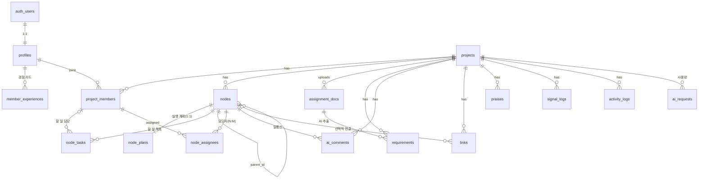

# Nodi — 데이터베이스 설계 (Supabase / Postgres)

전체 서비스 설계는 [CLAUDE.md](CLAUDE.md), AI 관련 테이블의 사용 방식은 [ai.md](ai.md)를 참고한다.

## 0. 설계 원칙
- **프로젝트(=팀 과제 1개)가 모든 데이터의 경계**다. 거의 모든 테이블에 `project_id`가 있고, RLS는 `is_member(project_id)` 하나로 통일한다.
- 프로젝트 생성과 초대코드 참여는 **RPC 함수(security definer)** 로만 한다. 멤버 행과 root 노드를 원자적으로 만들고 RLS 순서 문제를 피하기 위해서다.
- AI가 쓰는 테이블(`requirements` 일부, `ai_comments`, `ai_requests`)은 Edge Function이 service role로 기록한다. 사용자는 읽기와 제한된 수정만 한다.
- 버린 아이디어는 **삭제하지 않고 `status='discarded'`** 로 남긴다. 실제 삭제는 사용자가 명시적으로 할 때만 한다.
- 집계값(칭찬 온도, 신호등 누적 시간)은 컬럼으로 저장하지 않고 뷰/쿼리로 계산한다.
- 포커스 뷰(어떤 노드를 루트로 볼지)는 URL hash 상태라서 DB에 저장하지 않는다.
- **팀원 경험(`member_experiences`)은 프로젝트가 아니라 사용자에 묶는다.** 다른 팀플에서도 재사용하고, 같은 프로젝트 팀원에게만 보이게 한다.
- **노드의 실행 계획(`node_plans`)은 노드와 1:1인 별도 테이블**에 둔다. 노드 테이블은 캔버스 렌더링용으로 가볍게 유지하고, 계획 내용은 Inspector를 열 때만 불러온다.

## 1. ERD



## 2. 테이블 요약

| 테이블 | 용도 | 주요 컬럼 |
|---|---|---|
| `profiles` | 사용자 프로필 (auth.users 1:1) | display_name, major, skills[] |
| `member_experiences` | **팀원 경험 카드** (사용자 단위, 프로젝트 간 재사용) | kind, title, detail, level, tags[] |
| `node_plans` | **노드 실행 계획** (조사 방법, 구현 범위, 실행 가능성) | feasibility, research_methods, scope, risks, experience_ids[] |
| `projects` | 팀 과제 단위 | name, course_name, due_date, invite_code, **professor_note**(교수 요구사항 원문), **completed_at**(종료 → 지난 프로젝트) |
| `node_tasks` | **노드 할 일 목록** (AI 구체화 + 직접 추가) | node_id, content, done, assignee_id?, source(user\|ai), sort_order |
| `project_members` | 멤버십 + 멤버 색상 + **현재 신호등** | role, role_label, color, signal, signal_message |
| `nodes` | 아이디어 노드 (트리) | parent_id, title, description, status, is_candidate, source, x, y |
| `node_assignees` | 노드 담당자 (N:M, 중복 담당 가능) | node_id, user_id, task_state, note |
| `assignment_docs` | 업로드한 과제 공지/요구사항 문서 | storage_path, extracted_text, analyzed_at |
| `requirements` | AI가 구조화한 요구사항 (사용자가 편집 가능) | category, content, importance, source_quote |
| `ai_comments` | 노드 위 AI 말풍선 / 전체 점검 결과 | node_id(null=전체), kind, content, requirement_ids[] |
| `links` | 작업 링크 (Notion/회의록/Figma 등) | kind, title, url, node_id? |
| `praises` | 팀원 칭찬 = 좋아요 | from_user, to_user, message?(선택), tag?, created_on |
| `signal_logs` | 신호등 상태 구간 기록 (시간 측정) | signal, started_at, ended_at |
| `activity_logs` | 팀원별 활동 내역 (AI 역할 추천에 쓰임) | action, node_id, meta |
| `ai_requests` | AI 호출 기록 (사용량 제한, 비용 추적) | action, model, tokens |
| `member_temperature` (view) | 칭찬 온도 계산 | temperature, praise_count |
| `member_signal_time` (view) | 신호등 상태별 누적 시간 | signal, total_seconds |

## 3. 상태값 정의

| enum | 값 | 의미 |
|---|---|---|
| `node_status` | `considering` / `adopted` / `discarded` | 고민중(기본) / 채택 / 버림 |
| `signal_type` | `green` / `yellow` / `red` / `off` | 진행 중 / 쉬는 중 / 막힘·도움 필요 / 오프라인 |
| `task_state` | `todo` / `doing` / `done` | 담당자별 작업 진행 상태 |
| `link_kind` | `notion` / `meeting` / `figma` / `github` / `drive` / `other` | 링크 종류 (아이콘 표시용) |
| `ai_comment_kind` | `feedback` / `suggestion` / `warning` / `gap` / `praise` | 일반 피드백 / 방향 추천 / 요구사항 위반 우려 / 누락된 요구사항 / 잘한 점 |
| `requirement_category` | `topic` / `deliverable` / `constraint` / `criteria` / `deadline` / `etc` | 주제 / 제출물 / 제약 / 평가기준 / 일정 / 기타 |
| `experience_kind` | `project` / `research` / `tool` / `domain` / `role` | 프로젝트 / 조사·리서치 방법 / 도구·기술 / 도메인 지식 / 역할(발표, 문서 등) |
| `member_experiences.level` | `1` / `2` / `3` | 해봤음 / 혼자 할 수 있음 / 가르칠 수 있음 |

### `node_plans` JSON 컬럼 형식
```jsonc
// research_methods
[{ "method": "대학생 30명 대상 구글폼 설문", "why": "평가기준 R3 사용자 조사 근거",
   "experience_ids": ["<uuid>"], "owner_ids": ["<user uuid>"] }]

// scope
{ "mvp":          [{ "item": "Figma 프로토타입 5화면", "why": "Figma 숙련자 2명" }],
  "stretch":      [{ "item": "사용성 테스트 3명",     "why": "시간 여유가 있으면" }],
  "out_of_scope": [{ "item": "실제 앱 개발",          "why": "개발 경험자 없음, 과제 제약 R4상 필수 아님" }] }

// risks
[{ "risk": "데이터 분석 경험 없음", "mitigation": "엑셀 피벗 테이블로 단순 집계" }]
```

---

## 4. 마이그레이션 SQL

`supabase/migrations/` 아래에 섹션별로 나눠 넣거나, Supabase SQL Editor에서 순서대로 실행한다.

### 4.1 확장 & enum

```sql
-- 0001_types.sql
create extension if not exists pgcrypto;

create type node_status          as enum ('considering', 'adopted', 'discarded');
create type signal_type          as enum ('green', 'yellow', 'red', 'off');
create type task_state           as enum ('todo', 'doing', 'done');
create type link_kind            as enum ('notion', 'meeting', 'figma', 'github', 'drive', 'other');
create type ai_comment_kind      as enum ('feedback', 'suggestion', 'warning', 'gap', 'praise');
create type requirement_category as enum ('topic', 'deliverable', 'constraint', 'criteria', 'deadline', 'etc');
create type experience_kind      as enum ('project', 'research', 'tool', 'domain', 'role');
```

### 4.2 테이블

```sql
-- 0002_tables.sql

-- 사용자 프로필 ------------------------------------------------------------
create table public.profiles (
  id            uuid primary key references auth.users(id) on delete cascade,
  display_name  text not null check (char_length(display_name) between 1 and 30),
  avatar_url    text,
  major         text,                                 -- 전공
  skills        text[] not null default '{}',         -- 빠른 태그: {figma, react, 발표, 자료조사}
  created_at    timestamptz not null default now(),
  updated_at    timestamptz not null default now()
);

-- 팀원 경험 카드 (사용자 단위, 프로젝트 간 재사용) -------------------------
create table public.member_experiences (
  id          uuid primary key default gen_random_uuid(),
  user_id     uuid not null references public.profiles(id) on delete cascade default auth.uid(),
  kind        experience_kind not null,
  title       text not null check (char_length(title) between 1 and 60),   -- '교내 앱 공모전 UI 디자인'
  detail      text check (char_length(detail) <= 500),                       -- 무엇을 했고 결과가 어땠는지
  level       smallint not null default 1 check (level between 1 and 3),
  tags        text[] not null default '{}',                                  -- {figma, 사용자인터뷰}
  created_at  timestamptz not null default now(),
  updated_at  timestamptz not null default now()
);
create index on public.member_experiences (user_id);

-- 프로젝트 (팀 과제) ------------------------------------------------------
create table public.projects (
  id           uuid primary key default gen_random_uuid(),
  name         text not null check (char_length(name) between 1 and 60),
  course_name  text,
  description  text,
  due_date     date,
  invite_code  text not null unique
               default upper(substr(replace(gen_random_uuid()::text, '-', ''), 1, 6)),
  created_by   uuid references public.profiles(id) on delete set null,
  created_at   timestamptz not null default now(),
  updated_at   timestamptz not null default now()
);

-- 프로젝트 멤버 + 현재 신호등 --------------------------------------------
create table public.project_members (
  project_id         uuid not null references public.projects(id) on delete cascade,
  user_id            uuid not null references public.profiles(id) on delete cascade,
  role               text not null default 'member' check (role in ('owner', 'member')),
  role_label         text,                              -- 팀 내 역할: '기획', '디자인', '발표' ...
  color              text not null default '#6366F1' check (color ~ '^#[0-9A-Fa-f]{6}$'),
  signal             signal_type not null default 'off',
  signal_message     text check (char_length(signal_message) <= 80),
  signal_changed_at  timestamptz not null default now(),
  joined_at          timestamptz not null default now(),
  primary key (project_id, user_id)
);
create index on public.project_members (user_id);

-- 아이디어 노드 (트리) -----------------------------------------------------
create table public.nodes (
  id                     uuid primary key default gen_random_uuid(),
  project_id             uuid not null references public.projects(id) on delete cascade,
  parent_id              uuid,                          -- null = 프로젝트 root (프로젝트당 1개)
  title                  text not null check (char_length(title) between 1 and 100),
  description            text check (char_length(description) <= 2000),
  status                 node_status not null default 'considering',
  status_before_discard  node_status,                   -- 복구 시 돌아갈 상태
  is_candidate           boolean not null default false,-- ⭐ 아이디에이션 후보
  source                 text not null default 'user' check (source in ('user', 'ai')),
  x                      real not null default 0,
  y                      real not null default 0,
  created_by             uuid references public.profiles(id) on delete set null default auth.uid(),
  created_at             timestamptz not null default now(),
  updated_at             timestamptz not null default now(),
  unique (id, project_id),                              -- 복합 FK 대상
  foreign key (parent_id, project_id)                   -- 부모는 반드시 같은 프로젝트
    references public.nodes (id, project_id) on delete cascade
);
create index on public.nodes (project_id);
create index on public.nodes (parent_id);
create unique index nodes_one_root_per_project on public.nodes (project_id) where parent_id is null;

-- 노드 담당자 (N:M) --------------------------------------------------------
create table public.node_assignees (
  node_id      uuid not null,
  project_id   uuid not null,
  user_id      uuid not null,
  task_state   task_state not null default 'todo',
  note         text check (char_length(note) <= 300),   -- 담당자 개인 메모
  assigned_by  uuid references public.profiles(id) on delete set null default auth.uid(),
  assigned_at  timestamptz not null default now(),
  updated_at   timestamptz not null default now(),
  primary key (node_id, user_id),
  foreign key (node_id, project_id)  references public.nodes (id, project_id) on delete cascade,
  foreign key (project_id, user_id)  references public.project_members (project_id, user_id) on delete cascade
);
create index on public.node_assignees (project_id, user_id);

-- 노드 실행 계획 (노드 1:1) ------------------------------------------------
create table public.node_plans (
  node_id           uuid primary key,
  project_id        uuid not null,
  feasibility       smallint check (feasibility between 1 and 5),   -- 우리 팀 기준 실행 가능성
  feasibility_note  text,                                           -- 점수 근거 한 줄
  research_methods  jsonb not null default '[]',                    -- §3 형식 참고
  scope             jsonb not null default '{"mvp":[],"stretch":[],"out_of_scope":[]}',
  risks             jsonb not null default '[]',
  experience_ids    uuid[] not null default '{}',                   -- 근거가 된 경험 카드 (검색/표시용)
  generated_by_ai   boolean not null default true,
  edited_by_user    boolean not null default false,                 -- 사람이 수정하면 true → AI 재생성 시 확인
  generated_at      timestamptz,                                    -- 마지막 AI 생성 시각
  updated_at        timestamptz not null default now(),
  foreign key (node_id, project_id) references public.nodes (id, project_id) on delete cascade
);
create index on public.node_plans (project_id);

-- 과제 문서 -----------------------------------------------------------------
create table public.assignment_docs (
  id              uuid primary key default gen_random_uuid(),
  project_id      uuid not null references public.projects(id) on delete cascade,
  file_name       text not null,
  storage_path    text,                                 -- '<project_id>/<uuid>.pdf' (직접 붙여넣은 텍스트면 null)
  mime_type       text,
  extracted_text  text not null,                        -- 브라우저에서 추출한 원문 텍스트
  analyzed_at     timestamptz,                          -- AI 요구사항 추출 완료 시각
  uploaded_by     uuid references public.profiles(id) on delete set null default auth.uid(),
  created_at      timestamptz not null default now()
);
create index on public.assignment_docs (project_id);

-- 요구사항 (AI 추출 + 사용자 편집) ----------------------------------------
create table public.requirements (
  id            uuid primary key default gen_random_uuid(),
  project_id    uuid not null references public.projects(id) on delete cascade,
  doc_id        uuid references public.assignment_docs(id) on delete set null,
  category      requirement_category not null default 'etc',
  content       text not null check (char_length(content) <= 500),
  importance    smallint not null default 2 check (importance between 1 and 3), -- 3=필수
  source_quote  text,                                   -- 원문 근거 문장
  is_ai         boolean not null default true,
  sort_order    int not null default 0,
  created_at    timestamptz not null default now(),
  updated_at    timestamptz not null default now()
);
create index on public.requirements (project_id);

-- AI 코멘트 (노드 말풍선 / 전체 점검) -------------------------------------
create table public.ai_comments (
  id               uuid primary key default gen_random_uuid(),
  project_id       uuid not null references public.projects(id) on delete cascade,
  node_id          uuid references public.nodes(id) on delete cascade, -- null = 프로젝트 전체 리포트
  kind             ai_comment_kind not null default 'feedback',
  content          text not null,
  requirement_ids  uuid[] not null default '{}',        -- 근거가 된 요구사항
  experience_ids   uuid[] not null default '{}',        -- 근거가 된 팀원 경험 카드
  dismissed        boolean not null default false,      -- 사용자가 말풍선 숨김
  requested_by     uuid references public.profiles(id) on delete set null,
  created_at       timestamptz not null default now()
);
create index on public.ai_comments (project_id, node_id) where not dismissed;

-- 작업 링크 ------------------------------------------------------------------
create table public.links (
  id          uuid primary key default gen_random_uuid(),
  project_id  uuid not null references public.projects(id) on delete cascade,
  node_id     uuid references public.nodes(id) on delete set null,
  kind        link_kind not null default 'other',
  title       text not null check (char_length(title) between 1 and 80),
  url         text not null check (url ~* '^https?://'),
  created_by  uuid references public.profiles(id) on delete set null default auth.uid(),
  created_at  timestamptz not null default now()
);
create index on public.links (project_id);

-- 칭찬 ---------------------------------------------------------------------
create table public.praises (
  id          uuid primary key default gen_random_uuid(),
  project_id  uuid not null,
  from_user   uuid not null default auth.uid(),
  to_user     uuid not null,
  message     text not null check (char_length(message) between 1 and 200),
  tag         text,                                     -- '아이디어왕', '꼼꼼함', '시간약속' 등
  created_on  date not null default (now() at time zone 'Asia/Seoul')::date,
  created_at  timestamptz not null default now(),
  check (from_user <> to_user),
  unique (project_id, from_user, to_user, created_on),  -- 같은 사람에게 하루 1번
  foreign key (project_id, from_user) references public.project_members (project_id, user_id) on delete cascade,
  foreign key (project_id, to_user)   references public.project_members (project_id, user_id) on delete cascade
);
create index on public.praises (project_id, to_user);

-- 신호등 구간 기록 ---------------------------------------------------------
create table public.signal_logs (
  id          bigint generated always as identity primary key,
  project_id  uuid not null,
  user_id     uuid not null,
  signal      signal_type not null,
  message     text,
  started_at  timestamptz not null default now(),
  ended_at    timestamptz,                              -- null = 현재 진행 중인 구간
  foreign key (project_id, user_id) references public.project_members (project_id, user_id) on delete cascade
);
create index on public.signal_logs (project_id, user_id, started_at desc);

-- 활동 내역 ------------------------------------------------------------------
create table public.activity_logs (
  id          bigint generated always as identity primary key,
  project_id  uuid not null references public.projects(id) on delete cascade,
  user_id     uuid references public.profiles(id) on delete set null,
  action      text not null,  -- node_created | node_status_changed | node_assigned | task_state_changed | link_added | praised
  node_id     uuid references public.nodes(id) on delete set null,
  meta        jsonb not null default '{}',              -- {from:'considering', to:'adopted', title:'...'}
  created_at  timestamptz not null default now()
);
create index on public.activity_logs (project_id, user_id, created_at desc);

-- AI 호출 기록 ---------------------------------------------------------------
create table public.ai_requests (
  id                 bigint generated always as identity primary key,
  project_id         uuid not null references public.projects(id) on delete cascade,
  user_id            uuid references public.profiles(id) on delete set null,
  action             text not null,                     -- analyze_doc | generate_ideas | concretize_node | node_feedback | review_all | suggest_direction | suggest_roles | help_blocked
  model              text,
  prompt_tokens      int,
  completion_tokens  int,
  ok                 boolean not null default true,
  error              text,
  created_at         timestamptz not null default now()
);
create index on public.ai_requests (project_id, created_at desc);
create index on public.ai_requests (user_id, created_at desc);
```

### 4.3 헬퍼 함수 & 트리거

```sql
-- 0003_functions.sql

-- 멤버 여부 (RLS 전역에서 사용) -----------------------------------------
create or replace function public.is_member(p_project uuid)
returns boolean language sql stable security definer set search_path = public as $$
  select exists (
    select 1 from project_members where project_id = p_project and user_id = auth.uid()
  );
$$;

create or replace function public.is_owner(p_project uuid)
returns boolean language sql stable security definer set search_path = public as $$
  select exists (
    select 1 from project_members
    where project_id = p_project and user_id = auth.uid() and role = 'owner'
  );
$$;

-- updated_at 자동 갱신 -------------------------------------------------------
create or replace function public.touch_updated_at()
returns trigger language plpgsql as $$
begin new.updated_at = now(); return new; end $$;

create trigger trg_profiles_touch     before update on public.profiles       for each row execute function touch_updated_at();
create trigger trg_projects_touch     before update on public.projects       for each row execute function touch_updated_at();
create trigger trg_nodes_touch        before update on public.nodes          for each row execute function touch_updated_at();
create trigger trg_assignees_touch    before update on public.node_assignees for each row execute function touch_updated_at();
create trigger trg_requirements_touch before update on public.requirements   for each row execute function touch_updated_at();
create trigger trg_experiences_touch  before update on public.member_experiences for each row execute function touch_updated_at();
create trigger trg_plans_touch        before update on public.node_plans     for each row execute function touch_updated_at();

-- 사용자가 실행 계획을 직접 고치면 edited_by_user 표시 (Edge Function은 service_role이라 제외)
create or replace function public.mark_plan_edited()
returns trigger language plpgsql as $$
begin
  if coalesce(auth.role(), '') <> 'service_role' then
    new.edited_by_user := true;
  end if;
  return new;
end $$;

create trigger trg_plans_mark_edited
  before update on public.node_plans for each row execute function mark_plan_edited();

-- 회원가입 시 프로필 자동 생성 --------------------------------------------
create or replace function public.handle_new_user()
returns trigger language plpgsql security definer set search_path = public as $$
begin
  insert into profiles (id, display_name, avatar_url)
  values (
    new.id,
    coalesce(new.raw_user_meta_data->>'name', split_part(new.email, '@', 1)),
    new.raw_user_meta_data->>'avatar_url'
  );
  return new;
end $$;

create trigger on_auth_user_created
  after insert on auth.users for each row execute function public.handle_new_user();

-- 멤버 색상 팔레트 (가입 순서대로 배정) -----------------------------------
create or replace function public.next_member_color(p_project uuid)
returns text language sql stable as $$
  select (array['#6366F1','#EC4899','#F59E0B','#10B981','#3B82F6','#8B5CF6','#EF4444','#14B8A6'])
         [ (select count(*) from public.project_members where project_id = p_project) % 8 + 1 ];
$$;

-- RPC: 프로젝트 생성 (멤버 + root 노드 원자적 생성) ------------------------
create or replace function public.create_project(
  p_name text, p_course text default null, p_due date default null, p_description text default null
) returns public.projects
language plpgsql security definer set search_path = public as $$
declare v_project projects;
begin
  if auth.uid() is null then raise exception 'not authenticated'; end if;

  insert into projects (name, course_name, due_date, description, created_by)
  values (p_name, p_course, p_due, p_description, auth.uid())
  returning * into v_project;

  insert into project_members (project_id, user_id, role, color)
  values (v_project.id, auth.uid(), 'owner', next_member_color(v_project.id));

  insert into nodes (project_id, parent_id, title, description, created_by)
  values (v_project.id, null, p_name, p_description, auth.uid());

  return v_project;
end $$;

-- RPC: 초대코드로 참여 ------------------------------------------------------
create or replace function public.join_project(p_code text)
returns public.projects
language plpgsql security definer set search_path = public as $$
declare v_project projects;
begin
  if auth.uid() is null then raise exception 'not authenticated'; end if;

  select * into v_project from projects where invite_code = upper(trim(p_code));
  if not found then raise exception 'invalid invite code'; end if;

  insert into project_members (project_id, user_id, color)
  values (v_project.id, auth.uid(), next_member_color(v_project.id))
  on conflict do nothing;

  return v_project;
end $$;

-- 노드: 순환 참조 방지 + root 보호 + 버림/복구 처리 -----------------------
create or replace function public.nodes_before_write()
returns trigger language plpgsql as $$
begin
  -- 부모 변경 시 자기 자손 밑으로 들어가는 순환 금지
  if tg_op = 'UPDATE' and new.parent_id is distinct from old.parent_id then
    if old.parent_id is null then
      raise exception 'root node cannot be moved';
    end if;
    if new.parent_id is null then
      raise exception 'only one root per project';
    end if;
    if exists (
      with recursive sub as (
        select id from nodes where id = new.id
        union all
        select n.id from nodes n join sub on n.parent_id = sub.id
      ) select 1 from sub where id = new.parent_id
    ) then
      raise exception 'cycle detected';
    end if;
  end if;

  -- 버릴 때 이전 상태 기억, 복구는 클라이언트가 status_before_discard로 되돌림
  if tg_op = 'UPDATE' and new.status = 'discarded' and old.status <> 'discarded' then
    new.status_before_discard := old.status;
  elsif tg_op = 'UPDATE' and old.status = 'discarded' and new.status <> 'discarded' then
    new.status_before_discard := null;
  end if;

  return new;
end $$;

create trigger trg_nodes_before_write
  before update on public.nodes for each row execute function nodes_before_write();

-- root 노드 삭제 금지
create or replace function public.nodes_protect_root()
returns trigger language plpgsql as $$
begin
  if old.parent_id is null and exists (select 1 from projects where id = old.project_id) then
    raise exception 'root node cannot be deleted';
  end if;
  return old;
end $$;

create trigger trg_nodes_protect_root
  before delete on public.nodes for each row execute function nodes_protect_root();

-- 신호등: 상태 변경 시 구간 로그 닫고 새로 열기 ---------------------------
create or replace function public.log_signal_change()
returns trigger language plpgsql security definer set search_path = public as $$
begin
  if new.signal is distinct from old.signal or new.signal_message is distinct from old.signal_message then
    new.signal_changed_at := now();

    update signal_logs set ended_at = now()
    where project_id = new.project_id and user_id = new.user_id and ended_at is null;

    if new.signal <> 'off' then
      insert into signal_logs (project_id, user_id, signal, message)
      values (new.project_id, new.user_id, new.signal, new.signal_message);
    end if;
  end if;
  return new;
end $$;

create trigger trg_signal_change
  before update of signal, signal_message on public.project_members
  for each row execute function log_signal_change();

-- 활동 로그 자동 기록 --------------------------------------------------------
create or replace function public.log_node_activity()
returns trigger language plpgsql security definer set search_path = public as $$
begin
  if tg_op = 'INSERT' and new.parent_id is not null then
    insert into activity_logs (project_id, user_id, action, node_id, meta)
    values (new.project_id, auth.uid(), 'node_created', new.id,
            jsonb_build_object('title', new.title, 'source', new.source));
  elsif tg_op = 'UPDATE' and new.status <> old.status then
    insert into activity_logs (project_id, user_id, action, node_id, meta)
    values (new.project_id, auth.uid(), 'node_status_changed', new.id,
            jsonb_build_object('title', new.title, 'from', old.status, 'to', new.status));
  end if;
  return null;
end $$;

create trigger trg_nodes_activity
  after insert or update of status on public.nodes
  for each row execute function log_node_activity();

create or replace function public.log_assignee_activity()
returns trigger language plpgsql security definer set search_path = public as $$
declare v_title text;
begin
  select title into v_title from nodes where id = new.node_id;
  if tg_op = 'INSERT' then
    insert into activity_logs (project_id, user_id, action, node_id, meta)
    values (new.project_id, new.user_id, 'node_assigned', new.node_id,
            jsonb_build_object('title', v_title, 'by', auth.uid()));
  elsif new.task_state <> old.task_state then
    insert into activity_logs (project_id, user_id, action, node_id, meta)
    values (new.project_id, new.user_id, 'task_state_changed', new.node_id,
            jsonb_build_object('title', v_title, 'from', old.task_state, 'to', new.task_state));
  end if;
  return null;
end $$;

create trigger trg_assignees_activity
  after insert or update of task_state on public.node_assignees
  for each row execute function log_assignee_activity();
```

### 4.4 뷰

```sql
-- 0004_views.sql

-- 칭찬 온도: 36.5 + 0.3 × 받은 칭찬 수 (최대 99)
create view public.member_temperature with (security_invoker = true) as
select pm.project_id,
       pm.user_id,
       count(p.id)                                         as praise_count,
       least(99, 36.5 + 0.3 * count(p.id))::numeric(4,1)   as temperature
from public.project_members pm
left join public.praises p on p.project_id = pm.project_id and p.to_user = pm.user_id
group by pm.project_id, pm.user_id;

-- 신호등 상태별 누적 시간 (진행 중 구간은 now까지)
create view public.member_signal_time with (security_invoker = true) as
select project_id,
       user_id,
       signal,
       (started_at at time zone 'Asia/Seoul')::date                       as day,
       sum(extract(epoch from coalesce(ended_at, now()) - started_at))::int as total_seconds
from public.signal_logs
group by project_id, user_id, signal, day;

-- 팀원별 담당 현황 (오른쪽 패널 / AI 컨텍스트용)
create view public.member_workload with (security_invoker = true) as
select pm.project_id,
       pm.user_id,
       count(na.node_id)                                   as assigned_count,
       count(na.node_id) filter (where na.task_state = 'done') as done_count,
       count(na.node_id) filter (where na.task_state = 'doing') as doing_count
from public.project_members pm
left join public.node_assignees na on na.project_id = pm.project_id and na.user_id = pm.user_id
group by pm.project_id, pm.user_id;

-- 계획이 팀 경험보다 오래됐는지 (경험 카드가 그 뒤에 추가/수정되면 stale)
create view public.node_plan_freshness with (security_invoker = true) as
select np.node_id,
       np.project_id,
       np.generated_at,
       max(me.updated_at)                         as team_experience_updated_at,
       coalesce(max(me.updated_at) > np.generated_at, false) as is_stale
from public.node_plans np
join public.project_members pm on pm.project_id = np.project_id
left join public.member_experiences me on me.user_id = pm.user_id
group by np.node_id, np.project_id, np.generated_at;
```

### 4.5 RLS

```sql
-- 0005_rls.sql
alter table public.profiles        enable row level security;
alter table public.projects        enable row level security;
alter table public.project_members enable row level security;
alter table public.nodes           enable row level security;
alter table public.node_assignees  enable row level security;
alter table public.assignment_docs enable row level security;
alter table public.requirements    enable row level security;
alter table public.ai_comments     enable row level security;
alter table public.links           enable row level security;
alter table public.praises         enable row level security;
alter table public.signal_logs     enable row level security;
alter table public.activity_logs   enable row level security;
alter table public.ai_requests     enable row level security;
alter table public.member_experiences enable row level security;
alter table public.node_plans      enable row level security;

-- member_experiences: 본인 CRUD, 같은 프로젝트 팀원은 조회만
create policy "exp_select" on public.member_experiences for select to authenticated using (
  user_id = auth.uid() or exists (
    select 1 from project_members a join project_members b on a.project_id = b.project_id
    where a.user_id = auth.uid() and b.user_id = member_experiences.user_id
  )
);
create policy "exp_insert" on public.member_experiences for insert to authenticated with check (user_id = auth.uid());
create policy "exp_update" on public.member_experiences for update to authenticated using (user_id = auth.uid()) with check (user_id = auth.uid());
create policy "exp_delete" on public.member_experiences for delete to authenticated using (user_id = auth.uid());

-- node_plans: 멤버 조회/수정 (생성은 주로 Edge Function, 수동 작성도 허용)
create policy "plans_all" on public.node_plans for all to authenticated
  using (is_member(project_id)) with check (is_member(project_id));

-- profiles: 본인 + 같은 프로젝트 팀원 프로필 조회, 본인만 수정
create policy "profiles_select" on public.profiles for select to authenticated using (
  id = auth.uid() or exists (
    select 1 from project_members a join project_members b on a.project_id = b.project_id
    where a.user_id = auth.uid() and b.user_id = profiles.id
  )
);
create policy "profiles_update_self" on public.profiles for update to authenticated
  using (id = auth.uid()) with check (id = auth.uid());

-- projects: 멤버만 조회, owner만 수정/삭제, 생성은 RPC(create_project)로만
create policy "projects_select" on public.projects for select to authenticated using (is_member(id));
create policy "projects_update" on public.projects for update to authenticated using (is_owner(id));
create policy "projects_delete" on public.projects for delete to authenticated using (is_owner(id));

-- project_members: 멤버끼리 조회, 본인 행 수정(신호등/색/역할라벨), 본인 탈퇴 또는 owner가 내보내기
create policy "members_select" on public.project_members for select to authenticated using (is_member(project_id));
create policy "members_update" on public.project_members for update to authenticated
  using (user_id = auth.uid() or is_owner(project_id));
create policy "members_delete" on public.project_members for delete to authenticated
  using (user_id = auth.uid() or is_owner(project_id));
-- role 컬럼은 클라이언트가 바꿀 수 없게 컬럼 단위 권한 제한
revoke update on public.project_members from authenticated;
grant  update (role_label, color, signal, signal_message) on public.project_members to authenticated;

-- 멤버 공통 CRUD 테이블
create policy "nodes_all"     on public.nodes          for all to authenticated using (is_member(project_id)) with check (is_member(project_id));
create policy "assignees_all" on public.node_assignees for all to authenticated using (is_member(project_id)) with check (is_member(project_id));
create policy "links_all"     on public.links          for all to authenticated using (is_member(project_id)) with check (is_member(project_id));
create policy "docs_all"      on public.assignment_docs for all to authenticated using (is_member(project_id)) with check (is_member(project_id));
create policy "reqs_all"      on public.requirements   for all to authenticated using (is_member(project_id)) with check (is_member(project_id));

-- ai_comments: 조회 + dismissed 수정만 (생성은 Edge Function service role)
create policy "ai_comments_select" on public.ai_comments for select to authenticated using (is_member(project_id));
create policy "ai_comments_update" on public.ai_comments for update to authenticated using (is_member(project_id));
revoke update on public.ai_comments from authenticated;
grant  update (dismissed) on public.ai_comments to authenticated;

-- praises: 조회, 본인 명의로만 작성, 본인이 쓴 것만 삭제
create policy "praises_select" on public.praises for select to authenticated using (is_member(project_id));
create policy "praises_insert" on public.praises for insert to authenticated
  with check (is_member(project_id) and from_user = auth.uid());
create policy "praises_delete" on public.praises for delete to authenticated using (from_user = auth.uid());

-- 로그성 테이블: 조회만 (쓰기는 트리거 / Edge Function)
create policy "signal_logs_select"   on public.signal_logs   for select to authenticated using (is_member(project_id));
create policy "activity_logs_select" on public.activity_logs for select to authenticated using (is_member(project_id));
create policy "ai_requests_select"   on public.ai_requests   for select to authenticated using (is_member(project_id));

-- RPC 실행 권한
grant execute on function public.create_project(text, text, date, text) to authenticated;
grant execute on function public.join_project(text) to authenticated;
```

### 4.6 Storage

```sql
-- 0006_storage.sql
insert into storage.buckets (id, name, public, file_size_limit, allowed_mime_types)
values ('assignment-docs', 'assignment-docs', false, 10485760,  -- 10MB
        array['application/pdf', 'text/plain', 'text/markdown',
              'application/vnd.openxmlformats-officedocument.wordprocessingml.document']);

-- 경로 규칙: '<project_id>/<uuid>.<ext>'  → 첫 폴더명으로 멤버 검사
create policy "docs_read" on storage.objects for select to authenticated
  using (bucket_id = 'assignment-docs' and public.is_member(((storage.foldername(name))[1])::uuid));
create policy "docs_write" on storage.objects for insert to authenticated
  with check (bucket_id = 'assignment-docs' and public.is_member(((storage.foldername(name))[1])::uuid));
create policy "docs_delete" on storage.objects for delete to authenticated
  using (bucket_id = 'assignment-docs' and public.is_member(((storage.foldername(name))[1])::uuid));
```

### 4.7 Realtime

```sql
-- 0007_realtime.sql
alter publication supabase_realtime add table
  public.nodes, public.node_assignees, public.ai_comments,
  public.project_members, public.links, public.praises, public.requirements,
  public.node_plans, public.member_experiences;

-- DELETE 이벤트에서도 project_id 등 전체 old 행을 받기 위해
alter table public.nodes          replica identity full;
alter table public.node_assignees replica identity full;
alter table public.ai_comments    replica identity full;
alter table public.links          replica identity full;
```

> ⚠️ Supabase Realtime은 **DELETE 이벤트에 `filter`를 적용하지 않는다.** 클라이언트에서 `payload.old.project_id === currentProjectId`로 한 번 더 거른다. (RLS가 켜져 있으므로 다른 프로젝트 데이터 자체가 노출되지는 않는다.)

---

## 5. 자주 쓰는 쿼리 (supabase-js)

```js
// 프로젝트 생성 / 참여
const { data: project } = await supabase.rpc('create_project', { p_name: '캡스톤 앱', p_course: 'HCI', p_due: '2026-12-15' });
const { data: joined }  = await supabase.rpc('join_project', { p_code: 'A1B2C3' });

// 워크스페이스 초기 로드 (병렬)
const [nodes, members, assignees, comments, reqs, links, temps] = await Promise.all([
  supabase.from('nodes').select('*').eq('project_id', pid),
  supabase.from('project_members').select('*, profile:profiles(*)').eq('project_id', pid),
  supabase.from('node_assignees').select('*').eq('project_id', pid),
  supabase.from('ai_comments').select('*').eq('project_id', pid).eq('dismissed', false),
  supabase.from('requirements').select('*').eq('project_id', pid).order('sort_order'),
  supabase.from('links').select('*').eq('project_id', pid).order('created_at', { ascending: false }),
  supabase.from('member_temperature').select('*').eq('project_id', pid),
]);

// 상태 변경 / 버리기 / 복구
await supabase.from('nodes').update({ status: 'adopted' }).eq('id', nodeId);
await supabase.from('nodes').update({ status: 'discarded' }).eq('id', nodeId);
await supabase.from('nodes').update({ status: node.status_before_discard ?? 'considering' }).eq('id', nodeId);

// 드래그 앤 드롭 담당자 지정 (중복이면 무시)
await supabase.from('node_assignees')
  .upsert({ node_id, project_id: pid, user_id }, { onConflict: 'node_id,user_id', ignoreDuplicates: true });

// 신호등
await supabase.from('project_members')
  .update({ signal: 'red', signal_message: 'API 연동에서 막힘' })
  .eq('project_id', pid).eq('user_id', uid);

// 오늘 내 신호등 누적 시간
await supabase.from('member_signal_time').select('signal,total_seconds')
  .eq('project_id', pid).eq('user_id', uid).eq('day', todayKST);

// 경험 카드: 내 카드 추가 / 팀 전체 경험 (AI 컨텍스트, 팀원 패널)
await supabase.from('member_experiences')
  .insert({ kind: 'research', title: '학과 설문조사 분석', detail: '120명 응답 엑셀 정리', level: 2, tags: ['설문'] });
const memberIds = [...getState().members.keys()];
await supabase.from('member_experiences').select('*').in('user_id', memberIds);

// 노드 실행 계획 (Inspector 열 때만) + 최신 여부
await supabase.from('node_plans').select('*').eq('node_id', nodeId).maybeSingle();
await supabase.from('node_plan_freshness').select('is_stale').eq('node_id', nodeId).maybeSingle();

// 개인 페이지: 내 담당 노드
await supabase.from('node_assignees')
  .select('task_state, note, node:nodes(id, title, status, description)')
  .eq('project_id', pid).eq('user_id', uid);
```

## 6. 확장 메모
- 노드 댓글(사람 간 코멘트)이 필요하면 `node_comments(id, project_id, node_id, user_id, content, created_at)`를 `ai_comments`와 별도 테이블로 추가한다.
- 노드가 수백 개를 넘어 위치 업데이트가 잦아지면, 드래그 위치는 Realtime Broadcast로 실시간 공유하고 DB 저장은 `pointerup` 때 한 번만 한다(현재 설계대로).
- 프로젝트 하나에 과제 문서를 여러 번 올리면 요구사항이 중복될 수 있다. 재분석할 때는 해당 `doc_id`의 AI 요구사항(`is_ai=true`)을 지우고 다시 넣는다.

## 7. 변경 내역

### 2026-11-21 — IA v2 (`supabase/migrations/20261121000002_ia_restructure.sql`)
[ia.md](ia.md)의 새 정보 구조(HOME 탭 4개 → 프로젝트 상세 4개 영역)에 맞춰 추가했다. 이미 적용된 DB에 `supabase db push` 로 한 번 더 적용하면 된다 (재실행해도 안전).

| 변경 | 내용 | 쓰는 화면 |
|---|---|---|
| `projects.completed_at timestamptz` | 팀장이 종료 처리한 시각. NULL 이면 진행 중 | HOME home '지난 프로젝트', setting 프로젝트 종료 |
| `projects.professor_note text` (≤ 10000자) | 교수 요구사항 원문. 같은 텍스트로 `assignment_docs` 를 만들어 A1 분석 | setting 🎓 교수 요구사항 |
| `node_tasks` 테이블 | 노드별 할 일. `assignee_id` 는 `(project_id, assignee_id)` → `project_members` FK, 팀원이 나가면 `on delete set null (assignee_id)` (Postgres 15+) | Inspector ✅ 할 일 목록, 사이드바 나의 작업, me 내 할 일 |
| `praises.message` NULL 허용 | 좋아요는 메시지 없이 보낼 수 있다 (check: NULL 또는 1~200자) | 👍 팀원 칭찬하기 |

- 권한: `projects` 의 `completed_at`, `professor_note` 컬럼 update 를 authenticated 에 추가 (RLS `projects_update` 가 owner 만 허용). `node_tasks` 는 멤버 CRUD (`node_tasks_all`).
- Realtime: `node_tasks` 를 `supabase_realtime` publication 에 추가, `replica identity full`.
- AI(service role): `concretize_node` 가 `source='ai'` 할 일을 insert 하고, 재구체화 때 `source='ai' and done=false` 인 것만 지운다.

```sql
create table public.node_tasks (
  id           uuid primary key default gen_random_uuid(),
  project_id   uuid not null,
  node_id      uuid not null,
  content      text not null check (char_length(content) between 1 and 200),
  done         boolean not null default false,
  assignee_id  uuid,
  source       text not null default 'user' check (source in ('user', 'ai')),
  sort_order   int not null default 0,
  created_by   uuid default auth.uid() references public.profiles(id) on delete set null,
  created_at   timestamptz not null default now(),
  updated_at   timestamptz not null default now(),
  foreign key (node_id, project_id) references public.nodes (id, project_id) on delete cascade,
  foreign key (project_id, assignee_id)
    references public.project_members (project_id, user_id) on delete set null (assignee_id)
);
```

자주 쓰는 쿼리:
```js
// 노드 할 일 (워크스페이스 초기 로드)
await supabase.from('node_tasks').select('*').eq('project_id', pid).order('sort_order');
// 나의 작업: 나에게 배정된 할 일
await supabase.from('node_tasks').select('*, node:nodes(id, title, status)')
  .eq('project_id', pid).eq('assignee_id', uid).order('done').order('created_at');
// HOME 프로젝트 현황: 프로젝트별 내 담당 진행률
await supabase.from('node_assignees').select('project_id, task_state').eq('user_id', uid);
```
